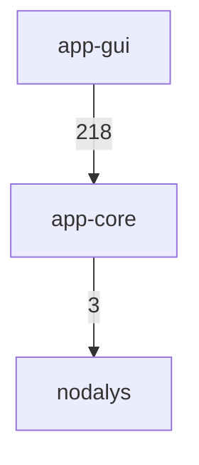
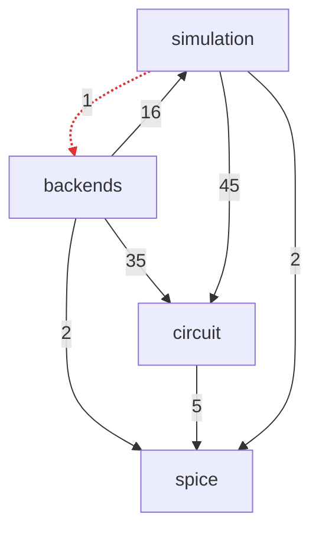
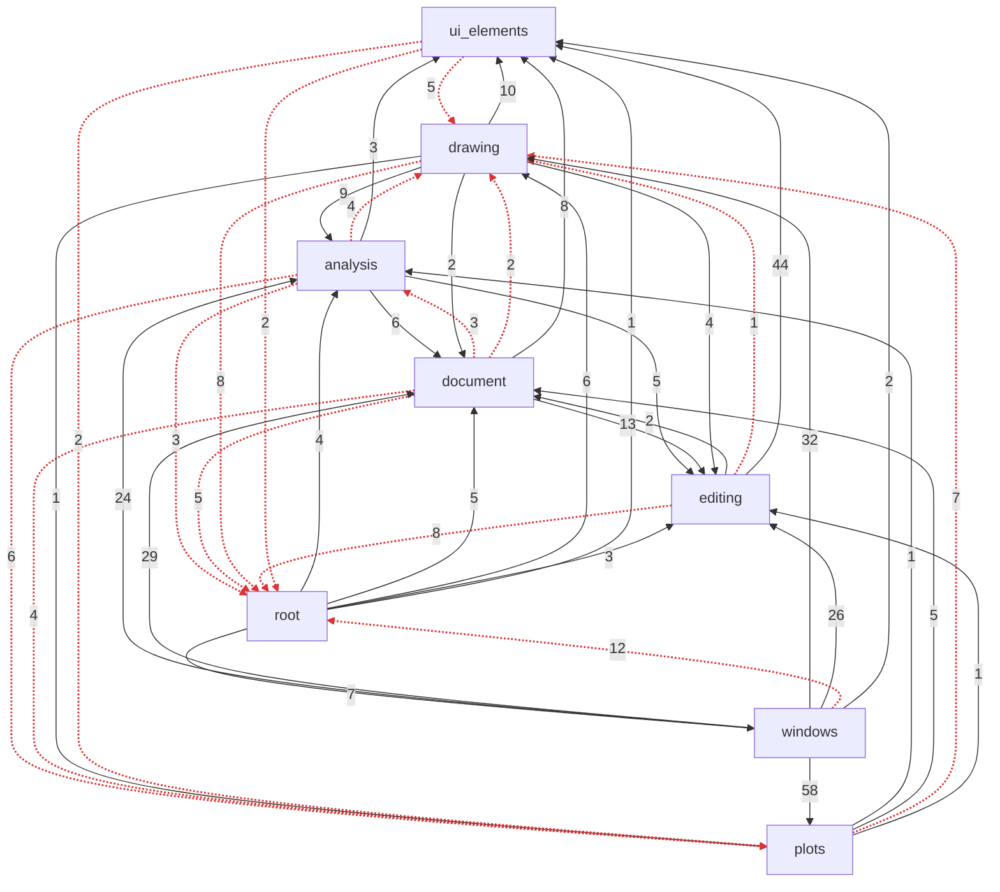

# Architecture

The include dependencies between the folders of imcsim, drawn from the `#include` lines of the sources by
`tools/include_layers.py`. An arrow from A to B means that files of A include files of B, and its number counts
those includes. The folders of each library are listed from the lowest layer to the highest, and a folder may only
include its own layer and the ones below it. A dashed red arrow goes the other way: it is a known violation, listed
in `tools/include_layers_baseline.json`, which `tools/include_layers.py --check` lets only shrink. Tracked
`app-core` and `app-gui` sources are read; `vendor/` and `tests/` are not.

Regenerate this file after a change that adds, removes or moves an include, with the project virtual environment
(the script uses only the standard library):

```
.venv/bin/python tools/include_layers.py
```

The CI runs `python tools/include_layers.py --check`, which fails when this file is out of date or when an include
goes up a layer without being in the baseline.

## Libraries



## app-core



Layers, lowest first:

1. `spice`
2. `circuit`
3. `simulation`
4. `backends`

## app-gui



Layers, lowest first:

1. `ui_elements`
2. `editing`, `document`
3. `analysis`
4. `plots`
5. `drawing`
6. `windows`
7. `root`
