# imcsim tutorial

This tutorial draws a circuit from an empty schematic, then builds a half-wave rectifier with a filter capacitor,
simulates it, reads the results and exports them. It takes about ten minutes and touches every part of the
application. The [user guide](user_guide.md) is the reference for what each control does, and
[Simulation models](models.md) describes the model behind every part.

The rectifier is a 1N4148 diode that charges a 1 µF capacitor from a 0 to 5 V square wave at 1 kHz, with a 1 kΩ load
across the capacitor. The diode conducts while the source is high; while it is low, the load drains the capacitor, so
the output sags until the next pulse. That sag, the ripple, is what the plots measure.

## 1. Draw a circuit

Start with File > New (Ctrl+N; on macOS, every Ctrl shortcut is Cmd). The window is the schematic editor: a toolbar
on top, the grid in the middle and a status bar at the bottom that always lists the keys of what you are doing.

The toolbar groups its buttons:

- Select, Wire and Probe, then Undo, Redo and Fit;
- resistor, capacitor and inductor;
- ground, VCC and the net label;
- sources, diodes, transistors, controlled sources, adjustable parts (potentiometer and transformer), switches (switch,
  push button, voltage-controlled switch and relay), logic gates and flip-flops, each a button with a dropdown arrow
  beside it that picks the part it places;
- the op-amp;
- Run, with the analysis it runs.

Hover any button for its name and shortcut.

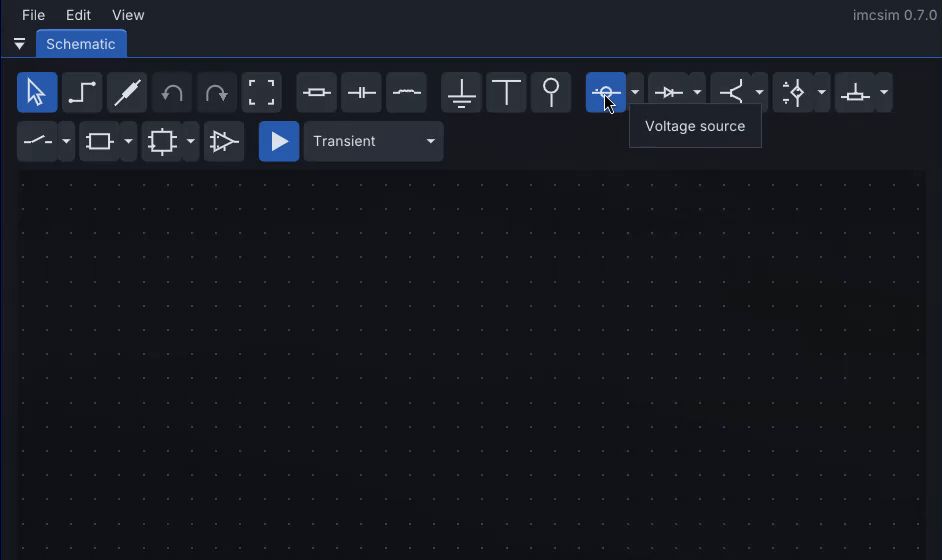

1. Click the first button of the sources group, the voltage source. It follows the cursor; click to place it. R
   rotates a part before the click, M mirrors it. Placing stays active, so you can drop several parts in a row;
   press Esc or right click to stop.
2. Place a resistor to the right of the source, a little higher, then a capacitor to the right of the resistor, and
   a ground below them.
3. Press W, or click the Wire button. Click a terminal to start a wire, click on the grid to add a bend, and click
   another terminal to end it. Wires run in straight segments; F flips the bend from horizontal-first to
   vertical-first. Connect the four parts in a loop and the ground to the bottom wire.

Parts are named in SPICE order as you place them: Vin1, R1, C1. A dot marks every junction where three or more wires
meet. Press Esc to leave wire mode; Ctrl+Z undoes any step.

## 2. Find a part

Instead of the toolbar, press Space over the editor and type part of a name, such as `dio`, `cap` or `mos`. Up and
Down move through the list and Enter, or a click, starts placing the part, which can be rotated with R before the
click that places it.

Start over with File > New and draw the rectifier: a voltage source, a diode found with `dio` to the right of it, a
capacitor below the diode's cathode and a resistor beside the capacitor, then a ground. Wire the source to the anode,
the cathode to the top of the capacitor and the resistor, and their bottoms to the source and the ground.

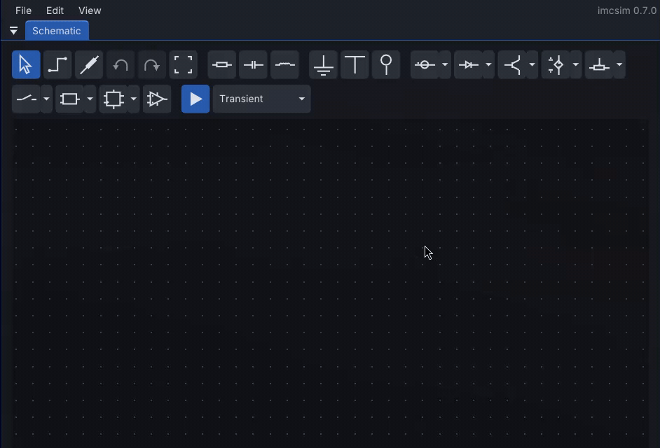

## 3. Edit a part

A double click on a part opens its properties in a popover beside it, as does Enter with the part selected. Edits
apply as you type; Enter, Esc or a click outside closes it. A right click opens everything else the part can do:
its properties, rotate, mirror, flip, measure its current and delete.

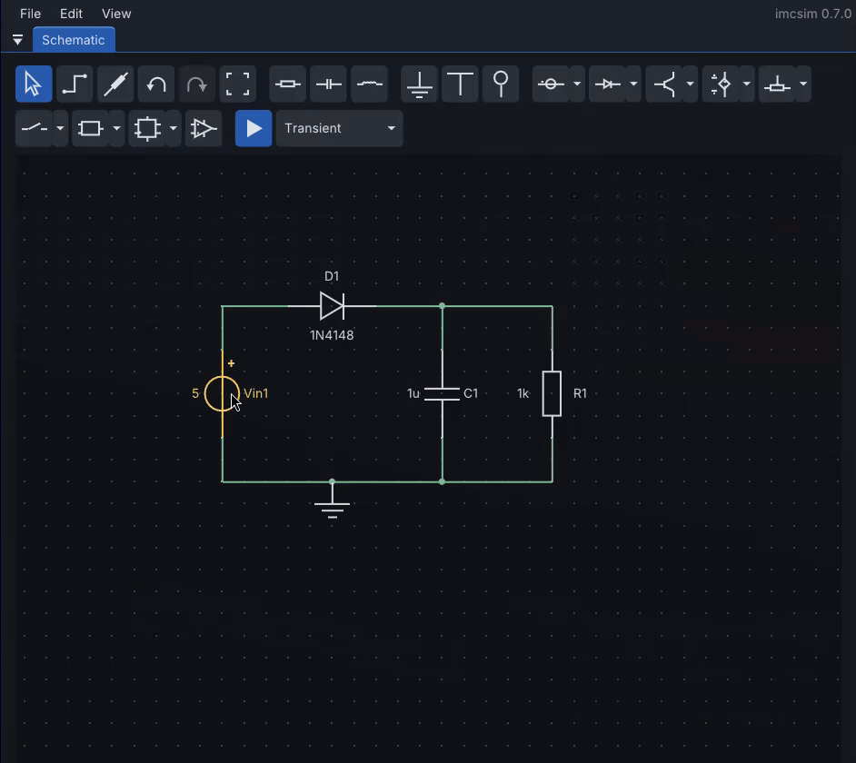

- **The source**: switch Vin1 from DC to Pulse. Its default is the square wave this tutorial needs: 0 V low, 5 V high,
  1 µs edges, 500 µs wide every 1 ms, so it repeats at 1 kHz.
- **The diode**: D1 takes the 1N4148 by default. Diodes, transistors and op-amps take a ready model or Custom, which
  shows the SPICE parameters of the model to edit one by one. This tutorial keeps the 1N4148.

Values take SPICE suffixes, case sensitive: T, G, M (mega), k, m (milli), u, n, p and f.

## 4. Choose what to measure

Plots show only what is measured. Press P, or click the Probe button, and hover a wire or a part: the tooltip says
what a click would measure. Clicking a wire measures the voltage of its node, clicking a part measures its current,
and clicking a measured item again stops measuring it. Click D1 for its current and the wire on top of R1 for the
output voltage, V(2). Each gets a colored mark on the schematic, in the color its trace will have.

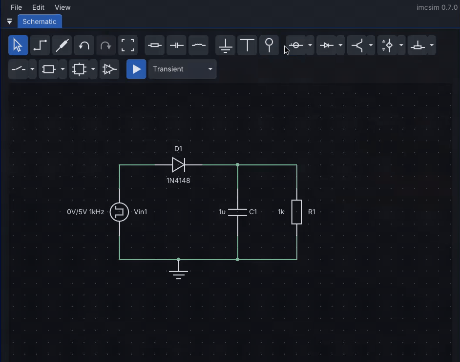

Press Esc to leave probe mode. You can also pick traces later in the Output window.

## 5. Run

The button beside Run names the analysis it runs. Click it to open the analysis list with the settings of the
selected one: pick Transient and click Suggest, which proposes settings from the sources and parts, here five periods
of the source (5 ms) with a 5 µs step.

Click Run, or press F5. ngspice runs the circuit, the status bar reports the result, and the Output window opens by
itself, as a tab beside the schematic, on the tab of the new analysis.

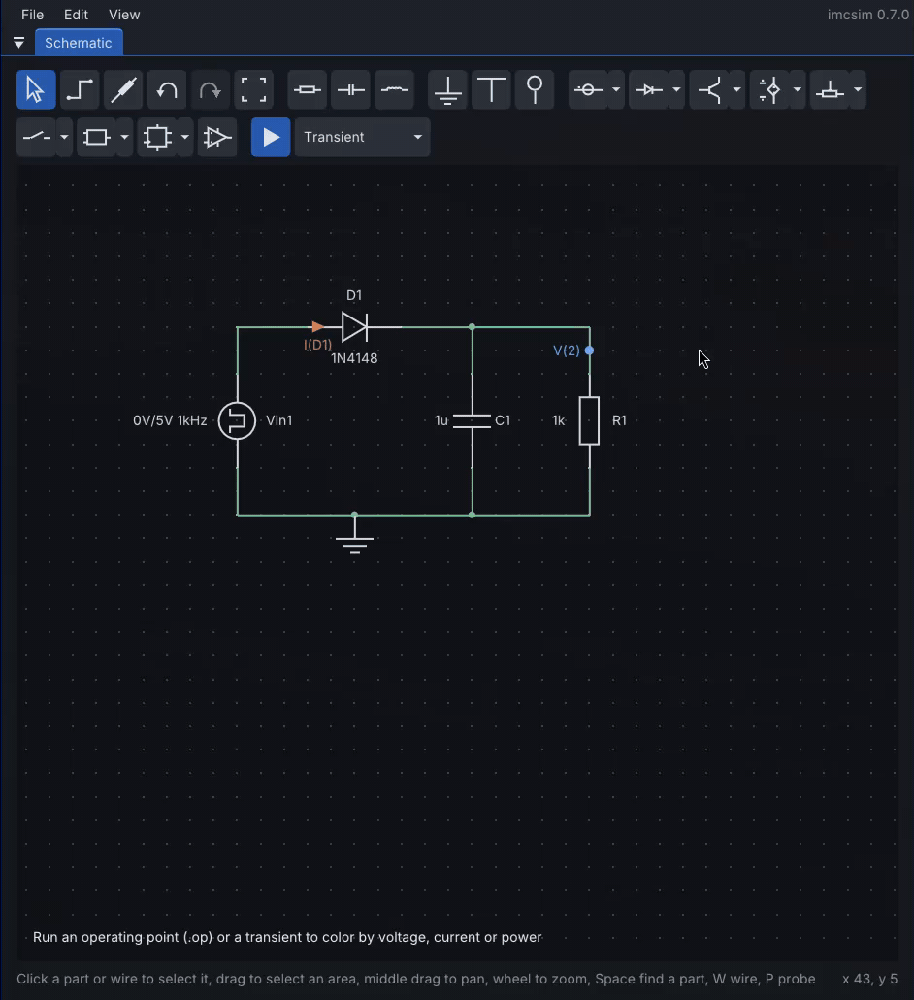

V(2) climbs to about 4.35 V, the 5 V pulse less the drop of the diode, and sags to about 2.64 V before the next pulse,
for a mean of about 3.88 V. I(D1) is a train of spikes: the source has no resistance and 1 µs edges, so each rising
edge refills the capacitor through the diode in a burst of about 1.9 A, and the first, from an empty capacitor,
reaches 3.8 A. The panel lists the peak-to-peak, mean, RMS and frequency of each trace.

Back on the schematic, a bar above the canvas holds the instant it shows: Play runs through the transient, with the
voltage labels and, under View > Wire Colors > Current, the wires following each spike. Drag the slider, or the red
line on the plot, to stop at any instant.

Every window can float or dock: drag it by its title or tab and drop it on one of the arrows that appear, to place it
beside, above or below another window or as a tab of it. The layout is kept for the next session, and View > Reset
Layout brings back the default one.

If a run fails, the status bar says so in red; click it for the error and the ngspice output.

## 6. Change a value

Parts with a single value take it straight from the keyboard: select R1 and type `220`, then Enter. A whole number may
put its decimals after the suffix, as resistor codes do: `4k7` is 4.7 kΩ.

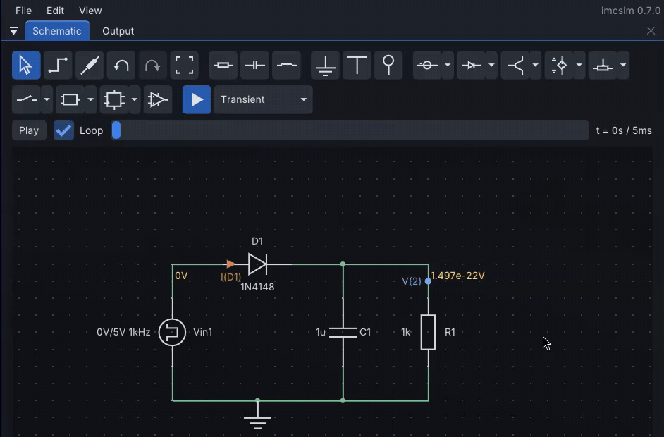

By default nothing runs by itself: after any edit, run again with F5. To have it follow your edits, turn on Run again
after edits in Edit > Preferences (Ctrl+,): once you have run an analysis, each change runs it again half a second
after the edit is over. With a 220 Ω load the capacitor drains almost five times faster: V(2) still peaks at about 4.27 V but drops below 0.5 V before each pulse, so the ripple is now most of the
output. The next plots use this transient.

## 7. Read the plots

- **Zoom and pan**: drag a box or use the wheel on the plot; double-click fits it again.
- **Trace list**: the column on the left turns traces on and off, voltages and currents apart.
- **Cursors**: check "Cursors A and B" and drag the two vertical lines. The panel shows the time between them and the
  statistics over that span only, with the value of each trace at each cursor. Put A on a peak of V(2) and B at the
  bottom of the sag to read the ripple and how long it takes.

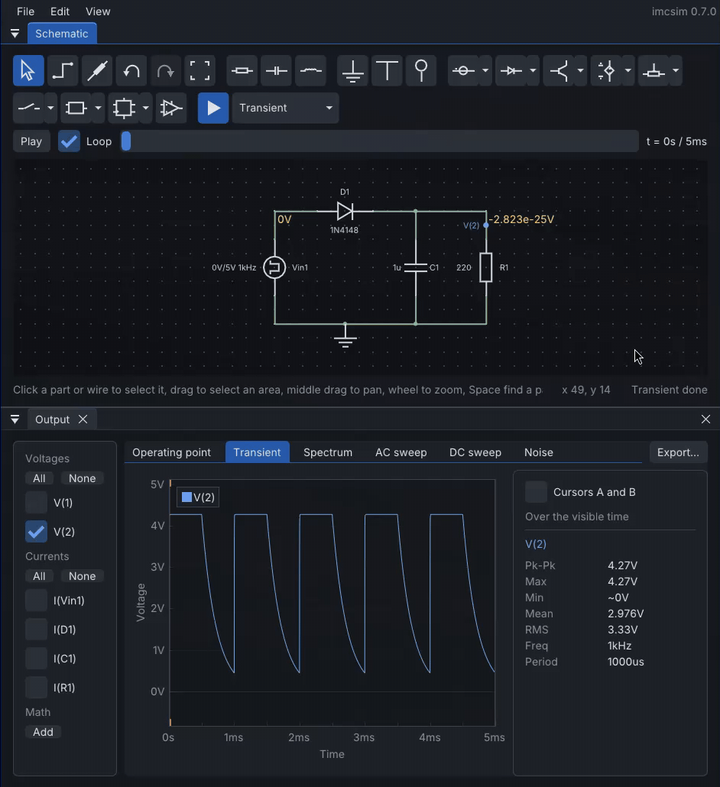

- **Math channels**: click Add under Math. A new channel starts as an operation between two traces, V(1) − V(2);
  change the operator to ×, then the traces to V(2) and I(R1): V(2) × I(R1) is the power the load takes. Its unit is
  worked out as you edit it, V² for V(1) × V(2) and W once the second trace is a current, and the plot gives it an
  axis of its own. It peaks at about 83 mW at the top of each pulse. A channel can also be an expression such as
  `V(1)-V(2)` or `ddt(V(2))`.

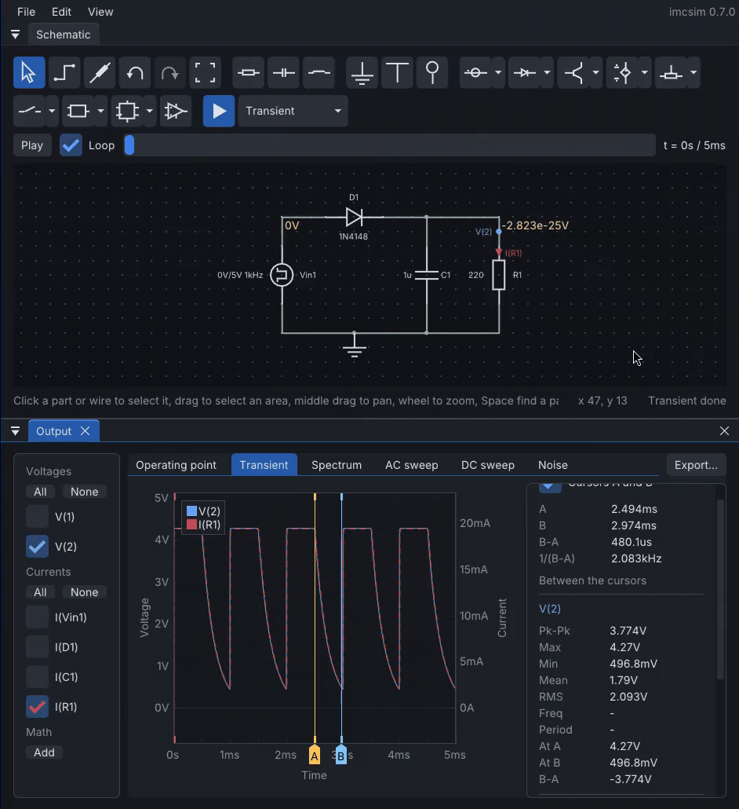

## 8. Other analyses

- **Operating point**: the DC voltages of every node, shown on the schematic and, with the currents, in the Output
  window. View > Wire Colors colors the wires by node, by voltage or by a current heat map that follows the path of
  the current, and Power colors the parts by the power they take. For the rectifier, the pulse source sits at 0 V
  before it starts, so everything reads 0 V; a divider of four equal resistors shows the voltage colors better, from
  blue at ground to red at the source:

  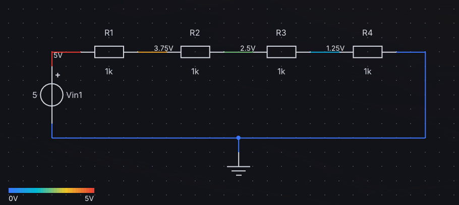

- **AC sweep of a larger circuit**: the Small-signal model of a BJT example compares a transistor stage with its
  hybrid-pi model:

  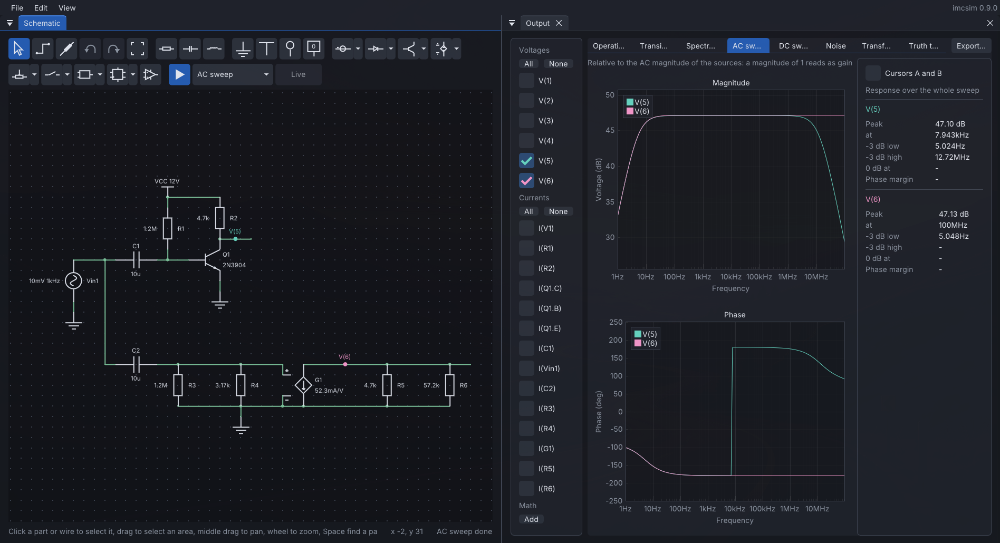

- **DC sweep**: steps a source through a range and plots the results against it, optionally stepping a second source
  for a family of curves. The BJT output characteristics example sweeps the collector voltage for five base
  currents:

  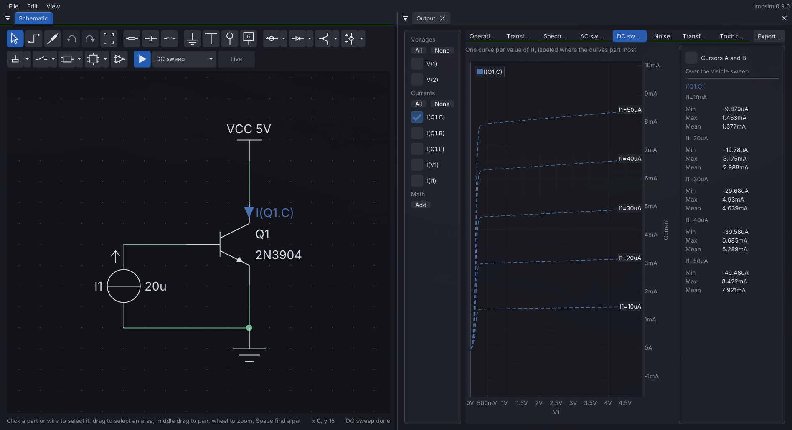

- **Spectrum**: the Spectrum tab of the Output window transforms the measured transient traces, as a spectrum analyzer
  would, and reads the fundamental, the harmonics and the THD of each, over the stretch the transient statistics
  measure.
- **Noise**: the random noise at one node across frequency, at the output and referred to the input, with the share
  of each part, so you see which resistor or transistor dominates.
- **Stepping a parameter**: the transient, AC sweep and DC sweep can run once per value of a resistor, capacitor,
  inductor or the temperature (Step a parameter, under their settings), and plot every step as a family of curves.

The [user guide](user_guide.md) explains each of them in detail.

View > Analysis Settings keeps the settings of the selected analysis open in a window, if you prefer them in view.

## 9. Export and save

Export... at the right of the Output tabs saves the plot of the current tab:

- **SVG image**: redrawn from the data, so it stays sharp at any size; light for print, or dark.
- **CSV table**: every sample of every measured trace, math channels included.

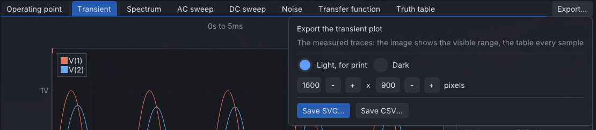

File > Export Schematic... saves the circuit as an SVG image with its probes in the colors of the traces, so the
schematic and the plots read as one figure.

Save the schematic with Ctrl+S. The file keeps the circuit, the selected analysis with the settings of every
analysis, and the measured nodes and currents, so reopening it is one F5 away from the same plots.

## Where to go next

- Open the other examples in File > Examples, sorted into Basics, Diodes, Transistors, Op-amps, Switching,
  Transformers and Digital; each has its analyses and measurements set up.
- Try the transistors, diodes and op-amps: each takes a ready model or custom SPICE parameters in its properties.
- View > Theme switches between nine color themes, shown side by side in [Themes](themes.md). Edit > Preferences
  gathers the theme with your other choices: IEC or ANSI symbols, terminal numbers, wire colors, live effects and
  standard values.
- Read the [user guide](user_guide.md) for terminal order, current signs and the details of each plot, and
  [Simulation models](models.md) for what each part leaves out.
